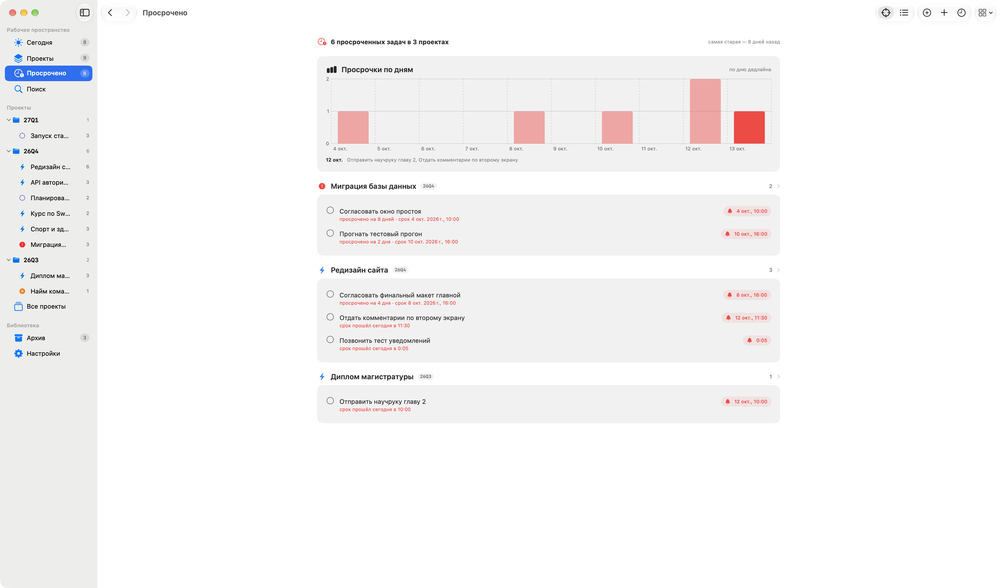
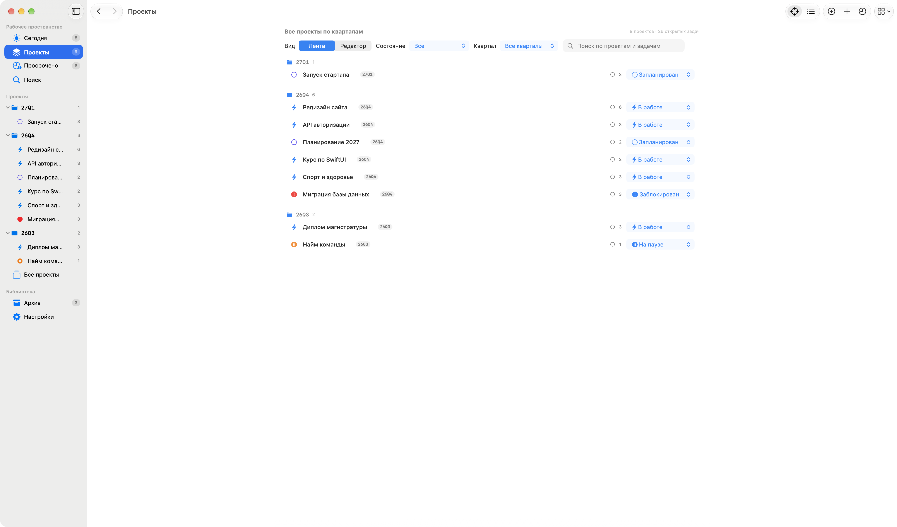
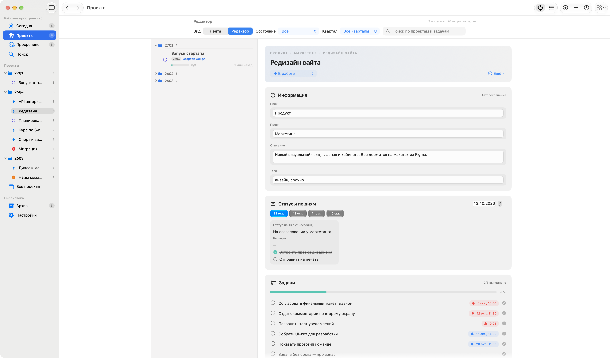
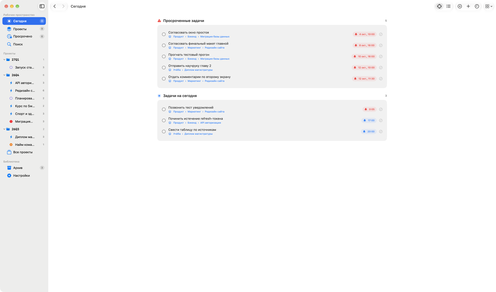
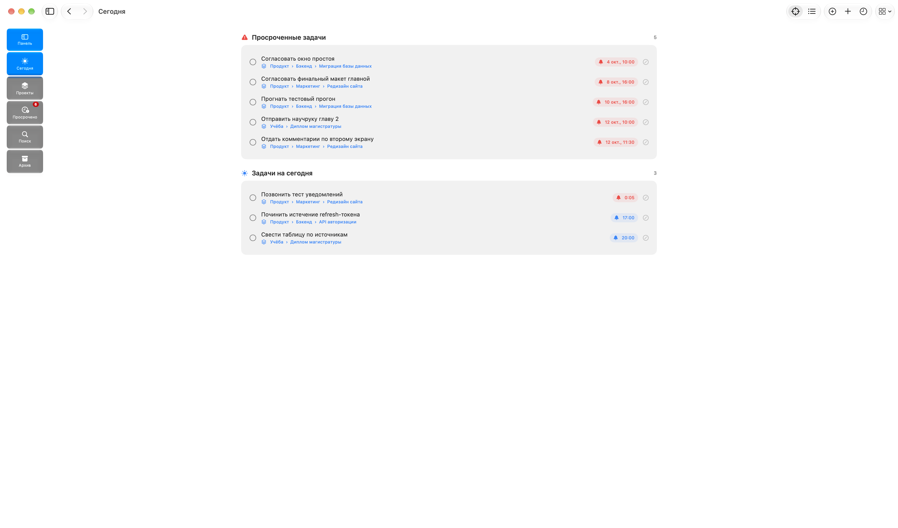

# Trace

Нативное macOS-приложение для ежедневного ведения проектов. Trace работает полностью локально: проекты и задачи хранятся в читаемых Markdown-файлах с YAML Frontmatter.

## Возможности

- экран «Сегодня» собирает просроченные, сегодняшние и ближайшие задачи в фокус дня;
- отдельный дашборд «Просрочено» (⌘3): все пропущенные сроки по проектам, самые старые сверху;
- лента проектов: каждый проект — карточка со своими задачами прямо в списке;
- фильтрация по состоянию и кварталам (`26Q3`, `26Q4`…), список кварталов строится по датам проектов;
- нативная боковая панель: вся строка проекта открывает его, выбор работает с клавиатуры;
- создание проекта по одному названию и явная команда переименования; старые эпики, иерархия, описания и теги сохраняются в Markdown;
- быстрый статус через ⌘⇧S или строку меню macOS; ⌘↩ дополняет запись дня без перехода к проекту;
- гайд «Статусы → Гайд: статусы из Confluence…» с копируемым промптом для модели;
- полезные ссылки с отдельным редактором названия/адреса и вставкой Markdown-ссылки;
- отдельный экран «Статусы» (⌘6): таблица «проекты × дни» на 3/5/7 дней или список полных записей за дату; выбранный вид запоминается, доступны поиск и фильтры блокеров/пропущенных записей;
- отдельный Markdown-редактор статуса с сохранением, отменой и Undo/Redo;
- история навигации «Назад/Вперёд» через `⌘[` / `⌘]` и быстрый доступ к проектам прямо из боковой панели;
- задачи-чекбоксы с дедлайном, временем и локальным системным уведомлением; в настройках есть «тестовое напоминание» для мгновенной проверки доставки;
- быстрый ввод с распознаванием срока: «завтра 18:00», «25.12», «в 14» превращаются в напоминание;
- единый редактор задачи: название, срок, проект, кнопка «Выполнено» прямо в уведомлении;
- полнотекстовый поиск по кириллице и латинице через `⌘K`;
- быстрый переход к недавним проектам через `⌘E` и поиск с автофокусом через `⌘F`;
- встроенная памятка по сочетаниям клавиш в панели инструментов и меню Help;
- навигация `⌘1…⌘5`, новая задача `⌘T`, новый проект `⌘N`;
- светлая, тёмная и системная темы;
- атомарная запись файлов и безопасное удаление проектов в системную Корзину.

## Скриншоты

Скриншоты ниже показывают предыдущую версию интерфейса. В текущей версии у статусов есть отдельный экран с таблицей и списком; отдельный список редактора и мини-навигация убраны.

**«Сегодня» (предыдущая версия):**


**«Просрочено» (⌘3)** — гистограмма просрочек по дням, сводка и задачи по проектам:



**«Проекты»** — папки-кварталы, карточки с задачами, прогрессом и полем быстрого ввода сроков:



**Редактор проекта** — инлайн-поля с автосохранением, статусы за любую дату, задачи:



**Режим «Фокус»** — только срочное, компактные строки проектов:



**Свёрнутый сайдбар** — glass-мини-навигация с подписями экранов:



Демо-данные для этих кадров: `python3 scripts/generate-demo-data.py`.

## Требования

- macOS 26 или новее;
- Xcode 26 или новее.

## Сборка и запуск

Откройте `ProjectTracking.xcodeproj`, выберите схему `ProjectTracking` и запустите приложение. Из терминала:

```bash
xcodebuild -project "ProjectTracking.xcodeproj" \
  -scheme ProjectTracking \
  -destination 'platform=macOS' \
  build
```

Тесты:

```bash
xcodebuild test -project "ProjectTracking.xcodeproj" \
  -scheme ProjectTracking \
  -destination 'platform=macOS' \
  CODE_SIGNING_ALLOWED=NO
```

## Проверка локальных уведомлений

В настройках Trace есть «Отправить тестовое напоминание». Через 5 секунд создаётся локальное уведомление; затем приложение проверяет, появилось ли оно среди доставленных в macOS. Диагностика отдельно показывает ожидающие напоминания и ближайший срок. Подтверждение доставки не означает, что система обязательно показала баннер: на отображение влияют «Фокусирование» и стиль уведомлений.

Для проверки на локальной сборке нужен подписанный пакет приложения. Команда тестов CI с `CODE_SIGNING_ALLOWED=NO` не предназначена для ручной проверки системных разрешений. Локальная ad hoc сборка:

```bash
xcodebuild -project ProjectTracking.xcodeproj -scheme ProjectTracking \
  -destination 'platform=macOS' -configuration Debug \
  CODE_SIGNING_ALLOWED=YES CODE_SIGN_IDENTITY=- CODE_SIGN_STYLE=Manual DEVELOPMENT_TEAM= build
```

При проверке 10 ноября 2026 unsigned-сборка получила `UNErrorDomain 1`, а на локально подписанной сборке macOS подтвердила доставку тестового уведомления. Для релизов остаётся предусмотренная в проекте Developer ID подпись/notarization при наличии секретов.

## Формат хранилища

По умолчанию Vault создаётся в Application Support. В настройках можно выбрать любую папку или корень Obsidian Vault. Проекты разложены по кварталам создания (формат `YYQN`), а завершённые (`done`/архив) автоматически переезжают в подпапку `Completed Projects` своего квартала:

```text
Vault/
├── README.md
└── Projects/
    └── 26Q4/
        ├── markdown-khranilishche/
        │   ├── Project.md
        │   └── Statuses/
        │       └── 2026-10-12-a1b2c3d4.md
        └── Completed Projects/
            └── diplom-zashchita/
                └── Project.md
```

Старая плоская структура `Projects/<slug>/` читается без ошибок и мягко мигрирует в квартальные папки при первом сохранении.

`Project.md` содержит YAML-поля `id`, `title`, `epic`, `parent_project`, `state`, `tags`, `created`, `updated`, `archived`. Ежедневные статусы лежат в `Statuses/YYYY-MM-DD-<8hex>.md` с разделами `## Статус` и `## Блокеры` — записи показываются в разделе «Статусы» таблицей по дням или списком за выбранную дату, а также в самом проекте. Задачи хранятся чекбоксами в разделе `## Задачи` и остаются совместимыми с Obsidian: дедлайн пишется прямо в строке задачи, например:

```markdown
- [ ] Отправить макет 📅 2026-10-20 ⏰ 18:30
```

Поля `epic`, `parent_project`, `summary` (раздел «Описание») и `tags` остаются совместимыми со старыми хранилищами: интерфейс их не предлагает, но чтение и сохранение не удаляют значения. Старый раздел `## Статус` и артефакты проекта также сохраняются. Имена разделов формата зарезервированы; другие Markdown-заголовки и fenced code внутри статуса поддерживаются. Перед сохранением блок кода нужно закрыть, а вложенные служебные заголовки оформить как `###`; при ошибке редактор сохраняет черновик.

Строки задач и артефактов могут заканчиваться невидимыми комментариями `<!-- trace-task-id:UUID -->` и `<!-- trace-artifact-id:UUID -->`. Они сохраняют привязку редактирования и уведомлений между запусками; файлы без комментариев также поддерживаются. Обычный Markdown-чекбокс, ссылка и формат срока остаются прежними.

[Перенос статусов из Confluence](docs/CONFLUENCE-STATUSES.md): скопировать промпт из меню приложения, передать текст модели, вставить ответ в «Быстрый статус» и проверить выбранный проект/день. Черновик быстрого статуса хранится в памяти до выхода из Trace.

Markdown является единственным источником данных. Напоминания создаются локально средствами macOS и не отправляют содержимое задач на сервер.

## Релизы

После каждого успешного `CI` в ветке `main` workflow `release.yml` автоматически создаёт SemVer-тег вида `v0.1.<номер CI>`, собирает приложение и публикует `.zip` и `.dmg` в GitHub Releases.

Описание релиза берётся из файла `releases/<version>.md` (например, `releases/0.1.5.md` или `releases/v0.1.5.md`), закоммиченного в релизный коммит. Если файла нет, release notes генерируются автоматически. Будущий релиз отражён в [`releases/NEXT.md`](releases/NEXT.md), заметки вышедших — рядом (`0.1.9.md` … `0.1.16.md`); структура — в [`EXAMPLE.md`](releases/EXAMPLE.md). Порядок выбора описания: точное совпадение → `NEXT.md` → последний существующий → `CHANGELOG.md`/автоген. Обновление папки: `python3 scripts/sync-release-notes.py`. Если файла для текущей версии нет, берётся `NEXT.md`, затем последний существующий `releases/<n>.md`. Экран «Что нового» в приложении всегда равен последнему релизу (`sync-release-notes.py` держит его свежим; CI при сборке подставляет заметки выпускаемой версии). Workflow также можно запустить вручную, указав нужную SemVer-версию, например `v1.2.3`.

Без секретов создаётся unsigned-сборка. Для подписи и notarization добавьте GitHub Actions secrets:

- `BUILD_CERTIFICATE_BASE64` — base64-кодированный `.p12`;
- `P12_PASSWORD`, `KEYCHAIN_PASSWORD`;
- `SIGNING_IDENTITY` — имя Developer ID Application сертификата;
- `APPLE_ID`, `APPLE_TEAM_ID`, `APP_PASSWORD` — данные для `notarytool`.

Приложение не использует сеть, аккаунты, аналитику или телеметрию.

## Быстродействие

Повторные обновления хранилища используют кэш разобранных Markdown-файлов с проверкой изменений; таблица показывает только нужные строки и короткие выдержки, а полная запись открывается отдельно. Архивирование выполняется вне главного потока. Методика и границы замеров — в [PERFORMANCE.md](docs/PERFORMANCE.md).
